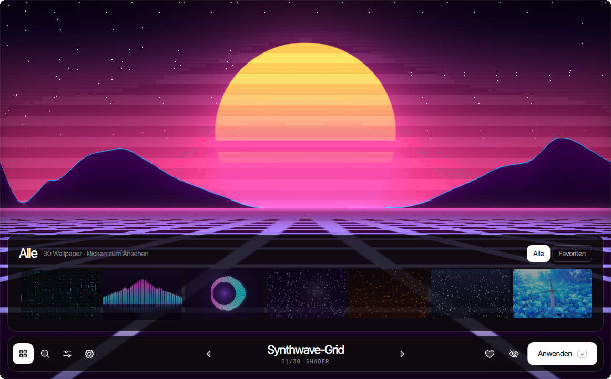
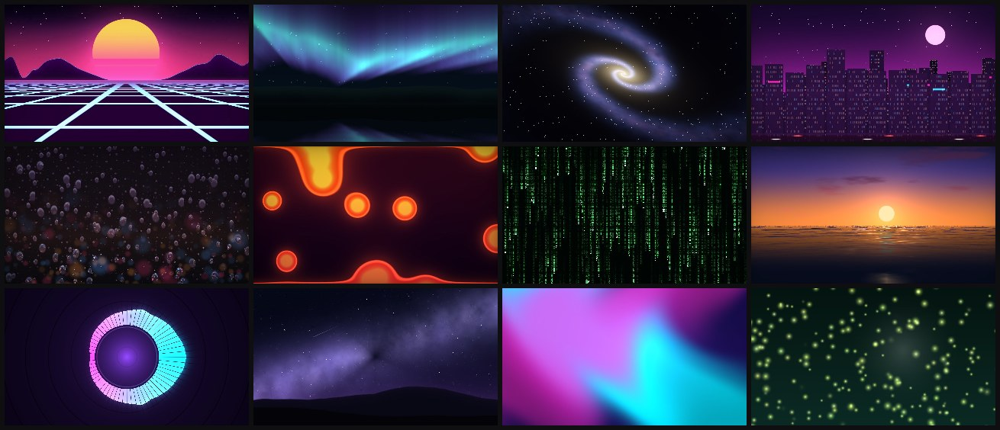

# Linux Wallpaper Engine

**Lebendige Hintergründe für KDE Plasma 6 unter Wayland** – Live-Shader, Partikel, Videos und GIFs
direkt auf dem Desktop, hinter allen Fenstern und Icons. Reagiert auf Maus und Musik, pausiert
sich selbst, wenn du spielst. Ein Befehl installiert alles nach `~/.local`, ohne `sudo`.





## Highlights

- **29 Wallpaper ab Werk** – 25 selbst geschriebene GLSL-Shader (Synthwave, Nordlicht, Galaxie,
  Neon-Stadt, Regen am Fenster, Matrix …) und 4 Partikel-Effekte, alle unter MIT-Lizenz
- **Echt im Hintergrund** – als Plasma-Wallpaper-Plugin, pro Monitor ein eigenes Wallpaper
- **Eigene Inhalte** – Videos, GIFs, Bilder und Shadertoy-Shader per Drag & Drop, Ordner-Import oder CLI
- **5 Leistungsstufen** – Winterschlaf, Cruise, Turbo, Overdrive (Ultra) und Hyperdrive (144 FPS + Supersampling); auch per `lwe quality <stufe>`
- **Spart Ressourcen** – pausiert bei Vollbild und Fenster-Vollbild (pro Monitor), FPS-Limit,
  Render-Auflösung pro Shader; Videos werden automatisch in GPU-dekodierbares AV1 umgewandelt
- **Interaktiv** – Parallaxe und Effekte folgen der Maus (auch unter Fenstern), Audio-Visualizer
- **Playlists** – Rotation im Intervall oder Tag/Nacht-Wechsel, pro Monitor
- **Sperrbildschirm** – das Wallpaper des ersten Monitors läuft auch beim Sperren (abschaltbar)
- **Unaufdringlich** – startet beim Login im Tray, schlichte App, Look komplett über `themes/*.json`

## Installieren / Deinstallieren

```bash
./install.sh          # alles nach ~/.local, kein sudo
./uninstall.sh        # entfernt Programm, Plugin, Autostart; Bibliothek + Einstellungen bleiben
./uninstall.sh --purge  # entfernt zusätzlich ~/.local/share/lwe komplett
```

Voraussetzungen (bei Fedora KDE meist schon da): `python3-pyside6`, `qt6-qtshadertools`,
`qt6-qtmultimedia`; optional `ffmpeg` (Video-Vorschaubilder) und `pulseaudio-utils` (Audio).
Fehlt etwas, sagt `install.sh` genau, was mit `dnf` nachzuinstallieren ist.

Bei der Deinstallation bekommt Plasma seinen normalen Hintergrund zurück (dein vorheriges Bild,
Plasma hat dessen Einstellung behalten).

## Benutzen

- **Starten:** Startmenü → „Linux Wallpaper Engine“ oder `lwe`. Beim Login startet es automatisch
  im Hintergrund (Tray-Symbol: Linksklick öffnet, Mittelklick pausiert, Rechtsklick = Menü).
- **Wallpaper setzen:** Kachel anklicken → rechts „Auf allen Bildschirmen“ oder einen Monitor anklicken.
- **Vorschau:** Maus über eine Kachel halten → läuft live (inkl. Maus-Reaktion).
- **Favoriten:** Herz auf der Kachel. Favoriten erscheinen auch im Tray-Menü.
- **Playlists:** Seite „Monitore“ → Monitor wählen → „Rotation“ oder „Tag / Nacht“.
- Das Fenster zu schließen beendet nur die Oberfläche (spart RAM); Wallpaper, Tray und Playlists laufen weiter.

## Neues Wallpaper hinzufügen

1. **Drag & Drop:** Dateien oder Ordner auf die Bibliothek ziehen.
2. **Knöpfe:** „Importieren“ (Dateien) oder „Ordner“ (alles Passende darin, rekursiv).
3. **Kommandozeile:** `lwe import ~/Videos/meer.webm ~/Bilder/Wallpaper/`

Unterstützt: Videos (`mp4 webm mkv mov m4v`), GIF, Bilder (`png jpg webp …`), Shader (`.frag .glsl`).
Importe landen in `~/.local/share/lwe/library/` (bei gleichem Dateisystem als Hardlink, kostet keinen Platz).

**Tipp für Videos:** Deine Grafikkarte dekodiert **VP9 und AV1** in Hardware (z. B. `.webm`).
H.264/H.265 (`.mp4`) funktioniert auch, wird mit den Fedora-Standardtreibern aber von der CPU dekodiert.

### Eigener Shader

Shadertoy-Format, eine Datei mit `mainImage`:

```glsl
void mainImage(out vec4 fragColor, in vec2 fragCoord) {
    vec2 uv = fragCoord / iResolution.xy;
    fragColor = vec4(0.5 + 0.5 * cos(iTime + uv.xyx + vec3(0, 2, 4)), 1.0);
}
```

Verfügbar: `iTime iTimeDelta iFrame iResolution iMouse iDate iChannel0` (Rausch-Textur) sowie
`iMouseUV` (Maus 0..1), `iAudio` (Bass, Mitten, Höhen, Pegel) und `lweSpectrum(x)` (16 Bänder).
Nicht unterstützt: Multipass/Buffers und eigene Texturen für `iChannel1..3`.
Beim Import wird der Shader kompiliert; Fehler werden angezeigt.

### Wallpaper-Paket (Ordner mit `wallpaper.json`)

```json
{ "title": "Mein Shader", "type": "shader", "file": "shader.frag",
  "tags": ["neon"], "author": "Ich", "license": "MIT", "defaults": { "renderScale": 0.75 } }
```

`type`: `shader | video | gif | image | particles`. Beispiele: `content/wallpapers/`.

## Kommandozeile

```
lwe                      Fenster öffnen          lwe set aurora --screen DP-1
lwe --tray               nur Hintergrund         lwe next [--screen HDMI-A-1]
lwe pause | resume | toggle                      lwe list | screens
lwe config fps 60        lwe config audio true   lwe quit | restore
```

## Themes

`themes/*.json` (mitgeliefert: Minimal (Standard), Neon Glass, Aurora Teal, Sunset Amber). Eigene Themes als JSON nach
`~/.local/share/lwe/themes/` kopieren und unter Einstellungen → Aussehen wählen.

## Technik – und warum

| Teil | Lösung | Warum |
|---|---|---|
| Anzeige | **Plasma-Wallpaper-Plugin** (QML, `plugin/`) | Läuft in plasmashell selbst, also garantiert hinter Fenstern *und* Desktop-Icons, pro Monitor, ohne Compositor-Tricks. Eine Layer-Shell-Fläche läge über den Plasma-Icons oder müsste sie ersetzen. |
| Shader | Shadertoy-GLSL → Qt `qsb` → `ShaderEffect` | Qt 6 braucht vorkompilierte Shader; Kompilieren beim Import fängt Fehler ab, bevor plasmashell sie sieht. |
| Video/GIF | QtMultimedia / AnimatedImage | Bordmittel von Plasma, Hardware-Dekodierung über VAAPI. |
| Partikel | QtQuick.Particles | Preset als JSON, keine Dateizugriffe aus plasmashell nötig. |
| App | Python + PySide6 + QML | Schnell, nutzt dieselben Renderer-Dateien wie das Plugin für die Live-Vorschau. |
| Maus | KWin-Script (`kwin/lwecursor`) → lokaler Port 127.0.0.1:47811 → Plugin | Unter Wayland kann nur KWin die globale Mausposition lesen; das Plugin selbst bekommt keine Maus-Events (die Icon-Ebene liegt darüber). |
| Audio | `parec` vom Monitor-Ausgang + eigene FFT | Nur Analyse, nichts wird gespeichert. ~0,4 ms pro Frame, kein numpy nötig. |
| Vollbild-Pause | Plasma-TaskManager-Modell im Plugin | Pro Monitor; Spiele im Vollbild pausieren nur den betroffenen Bildschirm. |

Web/HTML-Wallpaper sind bewusst noch nicht enthalten (können plasmashell instabil machen).

## Projektstruktur

```
plugin/com.lwe.wallpaper/   Plasma-Plugin (Renderer: Shader, Video, GIF, Bild, Partikel)
kwin/lwecursor/             KWin-Script für die Mausposition
app/lwe/                    Python-Backend (Bibliothek, Plasma-D-Bus, Playlists, Audio, Tray, CLI)
app/qml/                    Oberfläche
content/wallpapers/         mitgelieferte Wallpaper (Quelltext)
docs/                       Screenshots
themes/                     Theme-Dateien
spike/                      Machbarkeitstest vom Projektstart
tools/                      Entwickler-Werkzeuge (Kontaktbogen, Texturen)
```

Lizenz: MIT (siehe `LICENSE`). Alle mitgelieferten Shader, Icons und Texturen sind Eigenarbeit.
