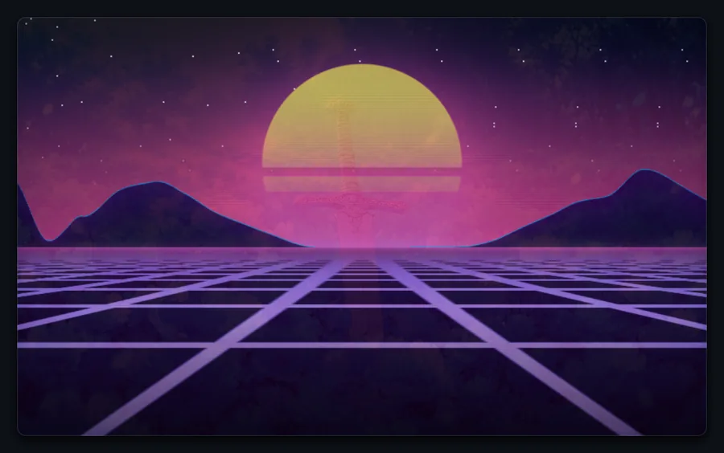
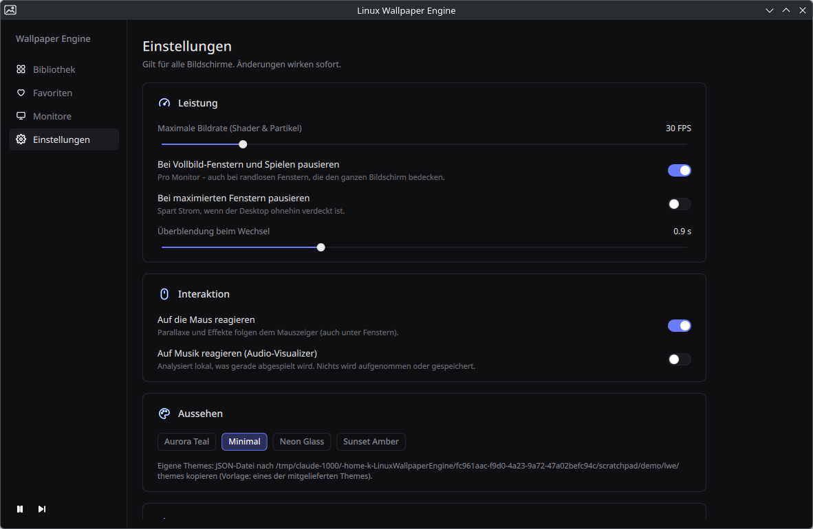

<div align="center">


# Fedorama

**Lebendige Hintergründe für KDE Plasma 6 unter Wayland.**<br>
Live-Shader, Partikel, Videos und GIFs direkt auf dem Desktop – hinter allen Fenstern und Icons.




</div>

<table>
<tr>
<td width="33%" valign="top">

### Schön
29 selbst geschriebene Wallpaper ab Werk – Synthwave, Nordlicht, Galaxie, Neon-Stadt,
Regen am Fenster … Dazu deine eigenen Videos, GIFs, Bilder und Shadertoy-Shader.

</td>
<td width="33%" valign="top">

### Schnell
Die App zeigt immer **ein** Wallpaper live und fensterfüllend. Blättern mit `←` `→`,
anwenden mit `Enter` – kein Raster, keine Menüs, keine Wartezeit.

</td>
<td width="33%" valign="top">

### Sparsam
Pausiert bei Spielen und Vollbild (pro Monitor), FPS-Limit, 5 Leistungsstufen,
Videos werden automatisch in GPU-dekodierbares AV1 umgewandelt.

</td>
</tr>
</table>


## Schnellstart

```bash
git clone https://github.com/Xinzoooo/linux-wallpaper-engine.git
cd linux-wallpaper-engine
./install.sh
```

Alles landet in `~/.local`, ohne `sudo`. Fehlt ein Paket, sagt `install.sh` genau, was mit `dnf`
nachzuinstallieren ist (bei Fedora KDE ist meist schon alles da).

## Was es kann

- **Echt im Hintergrund** – als Plasma-Wallpaper-Plugin, pro Monitor ein eigenes Wallpaper
- **Interaktiv** – Parallaxe und Effekte folgen der Maus (auch unter Fenstern), Audio-Visualizer
- **Playlists** – Rotation im Intervall oder Tag/Nacht-Wechsel, pro Monitor
- **Sperrbildschirm** – das Wallpaper läuft auch beim Sperren (abschaltbar)
- **5 Leistungsstufen** – Winterschlaf, Cruise, Turbo, Overdrive und Hyperdrive (144 FPS + Supersampling)
- **Aufräumen** – Wallpaper, die dir nicht gefallen, blendest du mit `Entf` aus
- **Unaufdringlich** – startet beim Login im Tray; die Oberfläche blendet sich aus, wenn die Maus ruht

## Bedienung

| Taste | Aktion | | Taste | Aktion |
|---|---|---|---|---|
| `←` `→` / Mausrad | blättern | | `A` | Anpassen (Helligkeit, Farbe, Tempo …) |
| `Enter` | anwenden | | `F` | Favorit |
| `Leertaste` | alle Wallpaper | | `Entf` | ausblenden |
| `/` | suchen | | `Esc` | Feld schließen |

Fenster verschieben: auf die freie Fläche klicken und ziehen. Größe: am Rand ziehen.
Schließen beendet nur die Oberfläche – Wallpaper, Tray und Playlists laufen weiter.

<p align="center"></p>

## Eigene Wallpaper

Dateien oder Ordner **ins Fenster ziehen**, in den Einstellungen auf „Video, Bild oder Shader
importieren“ klicken oder per Kommandozeile:

```bash
lwe import ~/Videos/meer.webm ~/Bilder/Wallpaper/
```

Unterstützt: Videos (`mp4 webm mkv mov m4v`), GIF, Bilder (`png jpg webp …`), Shader (`.frag .glsl`).

> [!TIP]
> Die Grafikkarte dekodiert **VP9 und AV1** in Hardware (z. B. `.webm`). H.264/H.265 (`.mp4`) geht auch,
> wird mit den Fedora-Standardtreibern aber von der CPU dekodiert – die App wandelt solche Videos
> deshalb automatisch um.

<details>
<summary><b>Eigener Shader (Shadertoy-Format)</b></summary>

Eine Datei mit `mainImage`:

```glsl
void mainImage(out vec4 fragColor, in vec2 fragCoord) {
    vec2 uv = fragCoord / iResolution.xy;
    fragColor = vec4(0.5 + 0.5 * cos(iTime + uv.xyx + vec3(0, 2, 4)), 1.0);
}
```

Verfügbar: `iTime iTimeDelta iFrame iResolution iMouse iDate iChannel0` (Rausch-Textur) sowie
`iMouseUV` (Maus 0..1), `iAudio` (Bass, Mitten, Höhen, Pegel) und `lweSpectrum(x)` (16 Bänder).
Nicht unterstützt: Multipass/Buffers und eigene Texturen für `iChannel1..3`.
Beim Import wird der Shader kompiliert; Fehler werden angezeigt.

</details>

<details>
<summary><b>Wallpaper-Paket (Ordner mit <code>wallpaper.json</code>)</b></summary>

```json
{ "title": "Mein Shader", "type": "shader", "file": "shader.frag",
  "tags": ["neon"], "author": "Ich", "license": "MIT", "defaults": { "renderScale": 0.75 } }
```

`type`: `shader | video | gif | image | particles`. Beispiele: `content/wallpapers/`.
Importe landen in `~/.local/share/lwe/library/` (bei gleichem Dateisystem als Hardlink, kostet keinen Platz).

</details>

<details>
<summary><b>Kommandozeile</b></summary>

```
lwe                      Fenster öffnen          lwe set aurora --screen DP-1
lwe --tray               nur Hintergrund         lwe next [--screen HDMI-A-1]
lwe pause | resume | toggle                      lwe list | screens
lwe config fps 60        lwe config audio true   lwe quit | restore
lwe quality cruise       Leistungsstufe          lwe import <dateien/ordner>
```

</details>

<details>
<summary><b>Technik – und warum</b></summary>

| Teil | Lösung | Warum |
|---|---|---|
| Anzeige | **Plasma-Wallpaper-Plugin** (QML, `plugin/`) | Läuft in plasmashell selbst, also garantiert hinter Fenstern *und* Desktop-Icons, pro Monitor, ohne Compositor-Tricks. Eine Layer-Shell-Fläche läge über den Plasma-Icons oder müsste sie ersetzen. |
| Shader | Shadertoy-GLSL → Qt `qsb` → `ShaderEffect` | Qt 6 braucht vorkompilierte Shader; Kompilieren beim Import fängt Fehler ab, bevor plasmashell sie sieht. |
| Video/GIF | QtMultimedia / AnimatedImage | Bordmittel von Plasma, Hardware-Dekodierung über VAAPI. |
| Partikel | QtQuick.Particles | Preset als JSON, keine Dateizugriffe aus plasmashell nötig. |
| App | Python + PySide6 + QML | Nutzt dieselben Renderer-Dateien wie das Plugin für die Live-Vorschau. |
| Maus | KWin-Script (`kwin/lwecursor`) → lokaler Port 127.0.0.1:47811 → Plugin | Unter Wayland kann nur KWin die globale Mausposition lesen; das Plugin selbst bekommt keine Maus-Events (die Icon-Ebene liegt darüber). |
| Audio | `parec` vom Monitor-Ausgang + eigene FFT | Nur Analyse, nichts wird gespeichert. ~0,4 ms pro Frame, kein numpy nötig. |
| Vollbild-Pause | Plasma-TaskManager-Modell im Plugin | Pro Monitor; Spiele im Vollbild pausieren nur den betroffenen Bildschirm. |

Web/HTML-Wallpaper sind bewusst noch nicht enthalten (können plasmashell instabil machen).

```
plugin/com.lwe.wallpaper/   Plasma-Plugin (Renderer: Shader, Video, GIF, Bild, Partikel)
plasmoid/com.lwe.panel/     Widget für die Kontrollleiste
kwin/lwecursor/             KWin-Script für die Mausposition
app/lwe/                    Python-Backend (Bibliothek, Plasma-D-Bus, Playlists, Audio, Tray, CLI)
app/qml/                    Oberfläche
content/wallpapers/         mitgelieferte Wallpaper (Quelltext)
tests/                      pytest (offscreen, fasst die echte Plasma-Sitzung nicht an)
docs/                       Screenshots und Demo
spike/                      Machbarkeitstest vom Projektstart
tools/                      Entwickler-Werkzeuge (Kontaktbogen, Texturen, Fensterschatten)
```

</details>

## Deinstallieren

```bash
./uninstall.sh          # entfernt Programm, Plugin, Autostart; Bibliothek + Einstellungen bleiben
./uninstall.sh --purge  # entfernt zusätzlich ~/.local/share/lwe komplett
```

Plasma bekommt danach seinen normalen Hintergrund zurück.

---

<sub>Lizenz: MIT (siehe `LICENSE`). Alle mitgelieferten Shader und Texturen sind Eigenarbeit.
Icons: [Phosphor](https://phosphoricons.com) (MIT). Schriften: Inter Tight und JetBrains Mono (SIL Open Font License).</sub>
